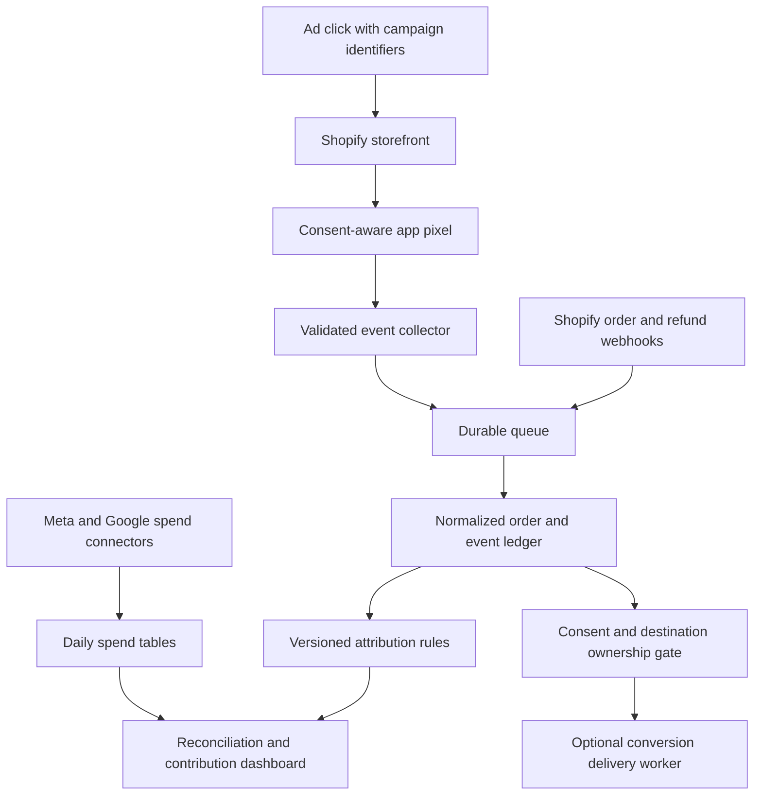

# How an ad-tracking platform works

This chapter is a proposed reference design, not a reverse-engineered description of any vendor's private code.

## Four separate jobs

1. **Collection:** Record a storefront interaction or confirmed order.
2. **Matching:** Associate that interaction with a session, customer, or order using available permitted identifiers.
3. **Attribution:** Apply a declared rule that allocates credit to eligible touchpoints.
4. **Activation:** Send eligible conversion signals to an ad platform.

A successfully delivered conversion is not necessarily matched to a person, attributed to an ad, or responsible for incremental revenue. These must be separate statuses in the product.

## Example journey

A shopper clicks Meta on Monday, returns through Google on Wednesday, then purchases directly on Friday.

- Shopify confirms one paid order with $100 of net merchandise revenue.
- If both clicks can legitimately be linked, first-click gives Meta $100; last non-direct gives Google $100.
- A linear model across those two eligible touches gives each $50.
- These are alternate views of the same $100, not $300 of sales.
- If only the Google click is observable, the report must not fabricate the Meta interaction.
- A later $20 merchandise refund reduces the restated net revenue to $80. An audit trail records the change.

This example assumes no taxes/shipping in the $100 and a lookback window that includes both clicks. It demonstrates rule-based attribution, not causal proof.

## Proposed end-to-end flow

### 1. Store installation

Connect a Shopify shop to a tenant through a validated install flow. Store tokens only on the server, register lifecycle webhooks, request minimal scopes, and configure the pixel. An install is not complete until a test order, a refund, and a reporting reconciliation have passed.

### 2. Storefront events

Use Shopify web pixel app extensions and their sandbox APIs to observe supported customer events. Do not assume unrestricted DOM access or inject an arbitrary checkout script. [Shopify web pixels](https://shopify.dev/docs/apps/build/marketing/pixels)

Record approved campaign parameters, click identifiers, event time, event ID, permitted session reference, and consent context. Strip unrelated URL parameters that may carry personal data. UTMs label a campaign; they do not identify a person or guarantee attribution across devices.

### 3. Orders and refunds

Use Shopify order data as the ledger baseline and browser checkout events as supporting evidence. Define when an order becomes eligible—proposed MVP: paid online-store orders; separately classify tests, cancellations, pending payments, POS, and draft orders.

Store original monetary components and later adjustments. Deduplicate webhook deliveries and reconcile missed or reordered changes. Shopify's checkout completion event can be absent if the relevant page fails to load. A paid order from Shopify should still appear in that case, with its attribution marked unknown when appropriate. [Shopify webhooks](https://shopify.dev/docs/apps/build/webhooks) · [Checkout completion event](https://shopify.dev/docs/api/web-pixels-api/standard-events/checkout_completed)

### 4. Identity and joins

Prefer a documented checkout/order reference, then a permitted first-party session link. Customer identifiers may connect known sessions within a shop when the required permissions and purposes allow it.

Do not join people solely by IP, infer cross-device certainty from similar devices, or share identity graphs between merchants. Preserve the evidence type: order reference, session link, known customer link, self-reported survey, or unknown. Hashing an identifier does not automatically make it anonymous.

Shopify grants access to the most recent 60 days of orders by default. Older orders require additional approval. Show the earliest imported order date separately from the date pixel collection started. An older paid order can be present in the ledger without any historical click to credit. [Shopify Order object](https://shopify.dev/docs/api/admin-graphql/latest/objects/Order)

### 5. Attribution calculation

The proposed first version supports first observed click and last non-direct click, with 7- and 28-day windows; 28 days is the initial default. These are product choices.

Specify eligibility, event-time ordering, lookback boundaries, direct-visit handling, and a stable tie-breaker. Version the rules. A later linear model must divide credit so allocations sum to the eligible order's value.

Keep paid, organic, referral, email, observed direct, and unknown buckets distinct. Missing UTMs do not prove direct traffic. Do not add views from an ad API to a shopper's journey unless the integration actually supports that association.

### 6. Spend normalization

Read campaign and ad costs using Meta Insights and Google Ads reporting. Persist provider IDs alongside names so renaming a campaign preserves its history. Store the account timezone, currency, reporting date, last successful sync and error state. Aggregate spend supplies the denominator for ROAS. Linking a particular purchase to a click still requires separate evidence. [Meta Insights](https://developers.facebook.com/documentation/ads-commerce/marketing-api/insights) · [Google Ads reporting](https://developers.google.com/google-ads/api/docs/reporting/overview)

A cross-channel total requires compatible currencies and date semantics. Show an unsupported-currency warning instead of adding dollars and euros. Proposed MVP supports one reporting currency with same-currency ad accounts; conversion support comes later.

### 7. Conversion delivery

Default to reporting-only when an existing native integration already owns purchase delivery. Shopify's Meta integration can already forward purchases server-to-server. A second sender can introduce duplicate conversions if its IDs do not align. [Shopify Meta data sharing](https://help.shopify.com/en/manual/promoting-marketing/analyze-marketing/meta-data-sharing)

Before activation, identify who already sends purchases to the destination. Meta documents matching the event name and event ID between a browser pixel and its corresponding server event for the same pixel within 48 hours. That pairing alone cannot establish that two independent server senders cooperate. Keep forwarding off until a test purchase produces one counted purchase for that merchant's configuration. [Meta deduplication guide](https://developers.facebook.com/documentation/ads-commerce/conversions-api/deduplicate-pixel-and-server-events)

Google Analytics Measurement Protocol sends data to GA4 and supplements tagging. It is not itself a Google Ads enhanced-conversion implementation. Choose and validate a specific supported Google Ads conversion path separately. [Measurement Protocol](https://developers.google.com/analytics/devguides/collection/protocol/ga4), [Google Ads server-side setup](https://developers.google.com/tag-platform/tag-manager/server-side/ads-setup)

Do not forward refunded orders as new purchases. Any destination-specific adjustments require a separately tested adapter.

## Limits the interface must communicate

- Server-side receipt of an order cannot recover an unobserved ad click automatically.
- Consent denial can reduce observable journeys; do not “fix” this by bypassing consent.
- Safari, blockers, cross-device visits, deleted cookies, and external checkout flows can break joins.
- An API acknowledgment proves transport acceptance, not inclusion in the platform's attributed results.
- Low-volume campaign fluctuations are not sufficient evidence to pause an ad.
- Attribution answers who receives credit under a rule. Incrementality requires a separate experimental or causal method.

